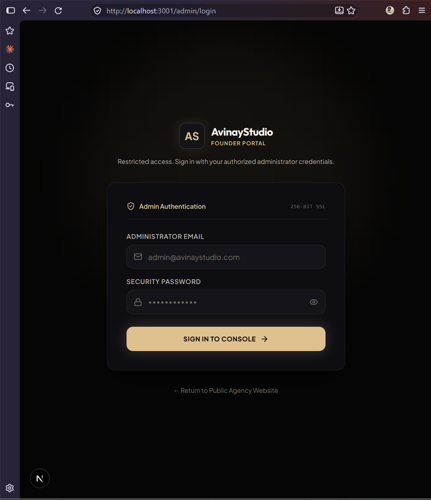
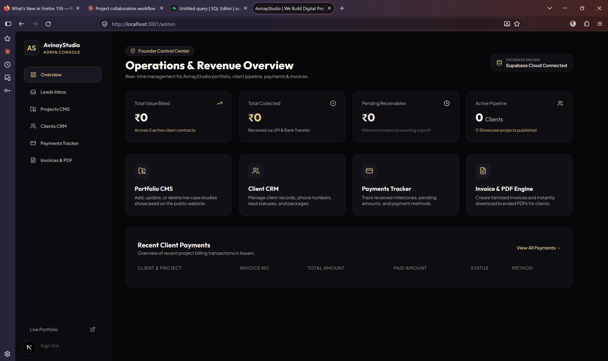
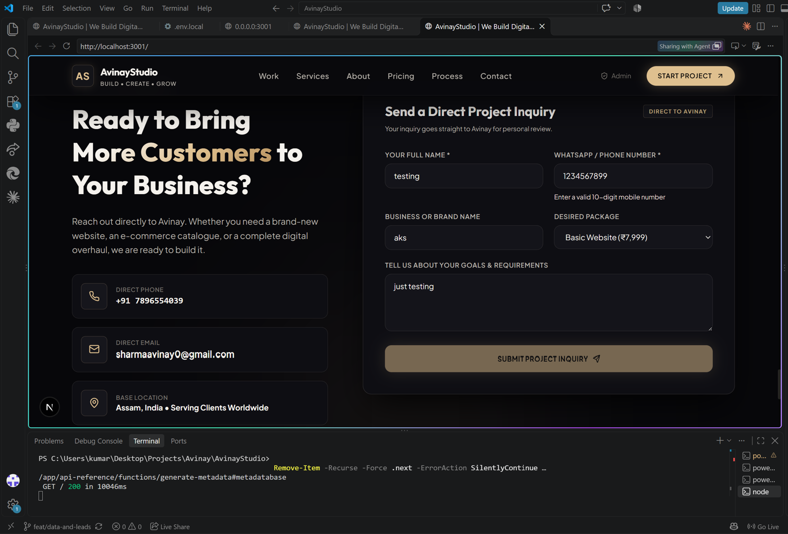
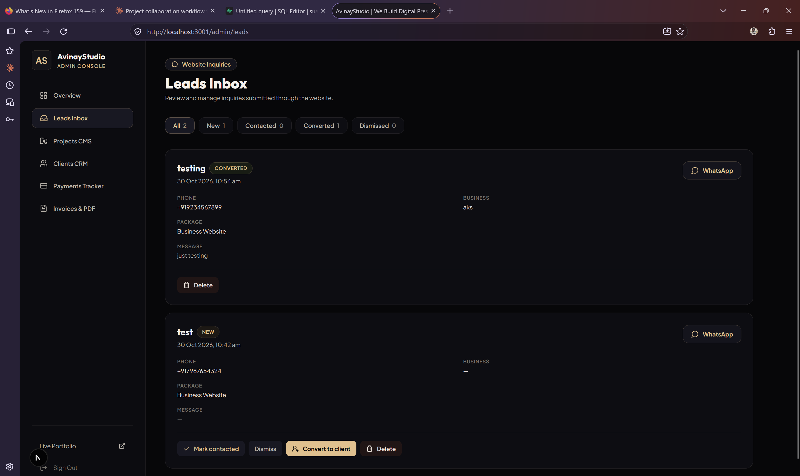
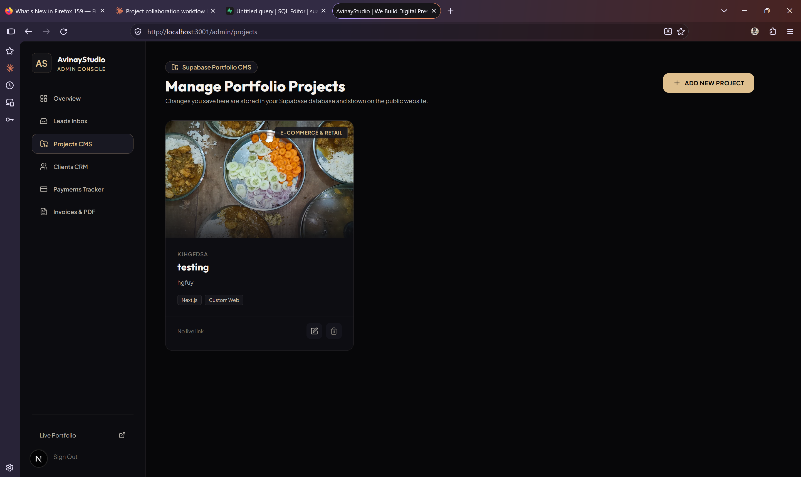

# Proof of Work: Security Hardening, Admin Auth and Leads Inbox

**Contributor:** Anish Kumar (@anishkr02)
**Branch:** `feat/data-and-leads`
**Goal:** make AvinayStudio safe to run in production, fix the bugs I found, and add a leads inbox.

> This file explains **what I changed, why, and how I tested it**, with screenshots, so the PR is easy to review and merge.

---

## 1. TL;DR for the reviewer

| | Before | After |
|---|---|---|
| `/admin` pages | Open to anyone (no login check) | Login required; only the admin account gets in |
| Database | RLS off / `using (true)`; anyone with the public anon key could read, edit or delete clients, payments, invoices | RLS on for every table; only the admin can touch private data |
| Contact form | Wrote straight into the `clients` table, and failed silently | Writes to a separate `leads` table (insert-only for the public); shows errors |
| Secrets in code | Supabase URL and anon key hardcoded; demo admin password `avinay2026` | Removed; `.env.example` added |
| `/api/sync` | Unauthenticated route that rewrote files on the server | Deleted |
| Live data | Silently fell back to fake sample data when the DB failed | Real loading and error states |

**Before merging, please read section 7 (required actions). The old key is in git history and must be rotated.**

---

## 2. Bugs and risks I found

| # | Severity | Problem |
|---|---|---|
| 1 | Critical | `/admin/*` had no auth guard; opening the URL showed all client data |
| 2 | Critical | Supabase RLS disabled or `using (true)`; the anon key is public, so the whole database was readable and writable by anyone |
| 3 | Critical | Hardcoded Supabase URL and anon key, plus the demo admin password, in the code and git history |
| 4 | Critical | `/api/sync` accepted unauthenticated POSTs and wrote files on the server |
| 5 | High | Storage bucket allowed public upload, update and delete |
| 6 | High | Contact form showed no error when saving failed; public visitors could insert into `clients` |
| 7 | High | App hid database failures by showing fake sample data |
| 8 | Medium | Wildcard image host (`**`), `any` types, no input validation |
| 9 | Low | WhatsApp number hardcoded in about 10 places |

---

## 3. What I changed, and why (by commit)

| Commit | Change | Why |
|---|---|---|
| `3438b29` | Removed `/api/sync`, the Sync button and related code | Unauthenticated and unsafe; it also breaks on serverless hosting |
| `51d8f9f` | `src/lib/siteConfig.ts` holds the phone and WhatsApp helper | One place to edit instead of ten |
| `350d04f` | `.env.example`, `.gitignore` update, image hosts restricted to Supabase | Stops secrets being committed; closes the wildcard image host |
| `567f19c` | `supabase/migrations/001_init.sql`: tables, RLS, `leads`, `is_admin()`, storage policies | Real database security (details in section 4) |
| `0216833` | Removed 4 old overlapping SQL files; added "Database setup" to the README | One clear source of truth |
| `04f1b9a` | Session-aware Supabase client, `src/middleware.ts`, Next.js bumped to 15.5.28 | Server-side guard on `/admin/*`; Next 15.2.x had a middleware auth-bypass bug |
| `335e37e` | Real Supabase email and password login and logout; removed demo credentials | Replaces a fake login stored in the browser |
| `92b90ee` | Typed data layer (`agencyData.ts`): real errors, no fallback, leads API | Failures are visible; no `any` |
| `fea9b03` | Contact form writes to `leads`; honeypot; image URL safety; seed only when DB is empty | Spam resistance; no crash on bad image URLs |
| `b92cc4b` | Admin loading and error states; image URL validation; deleted `initialData.ts` | No stale or fake data; save and delete errors are shown |
| `4466b9d` | **Leads Inbox** (`/admin/leads`) with convert-to-client | The one new feature: manage website inquiries |
| `0f810c7` | Phone input accepts only a 10-digit Indian mobile number (starts 6-9) | Bad numbers were possible |

---

## 4. How the security works

- **Admin identity:** a Supabase Auth user whose `app_metadata.role` is `admin`. Users cannot edit `app_metadata` themselves (unlike `user_metadata`), so it can't be spoofed from the browser.
- **Two layers:** middleware keeps non-admins out of `/admin/*`, and **RLS in the database** makes the real decision, so calling the API directly still fails.
- **Public visitors** (anon key) can only: read **featured** projects, and insert a lead. Nothing else.
- **`leads` table:** length and status checks; the public can't set `Converted` or read other leads.
- **Storage:** public can view images by URL, but only the admin can upload, change or delete (5 MB, image types only).

---

## 5. Screenshots (proof it works)

> Images live in `docs/proof/`. All data shown is test data from my own Supabase project.

### 5.1 Logged-out visit to `/admin` lands on the real login page
Before this PR, `/admin` opened straight into the dashboard with no login.



### 5.2 Admin dashboard after logging in with a real Supabase account


### 5.3 Contact form: phone validation (must be a 10-digit Indian mobile starting 6-9)
`1234567899` starts with 1, so the form shows the error and keeps Submit disabled.



### 5.4 New Leads Inbox: website inquiries, with one converted to a client


### 5.5 Projects CMS: uploaded image served from Supabase Storage (admin-only upload)


The database security test (anonymous visitor) is shown as a results table in section 6 below.

---

## 6. Test results (own Supabase project)

**Anonymous requests (public anon key only):**

| Test | Expected | Result |
|---|---|---|
| Read `clients`, `payments`, `invoices`, `leads` | Blocked | Blocked (401) |
| Read `projects` | Featured only | OK, featured only |
| Delete all `projects` | Blocked | Blocked (401) |
| Insert lead with `status = 'Converted'` | Blocked | Blocked (401) |
| Insert a normal lead | Allowed | OK |

**App flow:** logged-out `/admin` redirects to login; wrong password shows an error; non-admin accounts are signed out; lead submit, inbox, convert to client works; featured project shows on the public site; `npm run build` passes.

---

## 7. Required actions before merging or deploying

1. **Rotate the Supabase anon and JWT keys and change the admin password.** The old key and demo password are in git history; removing them from the code does not make them safe.
2. Run `supabase/migrations/001_init.sql` in the Supabase SQL Editor (a "destructive operation" warning is expected because of `drop policy if exists`).
3. Create the admin user (Authentication > Users > Add user, tick *Auto Confirm*), then promote it:
   ```sql
   update auth.users
   set raw_app_meta_data = raw_app_meta_data || '{"role":"admin"}'::jsonb
   where email = 'YOUR_EMAIL';
   ```
   Log out and in again so the new login token contains the role.
4. In Vercel, set `NEXT_PUBLIC_SUPABASE_URL` and `NEXT_PUBLIC_SUPABASE_ANON_KEY`, then **redeploy** (`NEXT_PUBLIC_` values are baked in at build time). When I checked the live site it made no Supabase requests, so these are probably unset there, which would also explain the contact form not saving.
5. The migration creates **empty** tables. Copy any real rows from the old database first.

---

## 8. How to run it locally

```bash
git clone https://github.com/anishkr02/AvinayStudio.git
cd AvinayStudio
cp .env.example .env.local      # fill in your own Supabase URL and anon key
npm install
npm run dev                      # http://localhost:3001
```
Then follow "Database setup" in `README.md`.

---

## 9. Known limits and follow-ups (not in this PR)

- SEO metadata (`metadataBase` warning), email or WhatsApp notification on a new lead.
- Rate limiting beyond the honeypot; a database-level phone format check.
- `alter default privileges` so future tables don't get open grants by default.
- Automated tests (there are none today).

---

## 10. Tips for the reviewer

- Review commit by commit; each is small and has one purpose.
- Don't run `npm run build` while `npm run dev` is running (they share the `.next` folder and the dev server breaks; delete `.next` and restart if it happens).
- Questions or smaller PRs? I'm happy to split this up.
